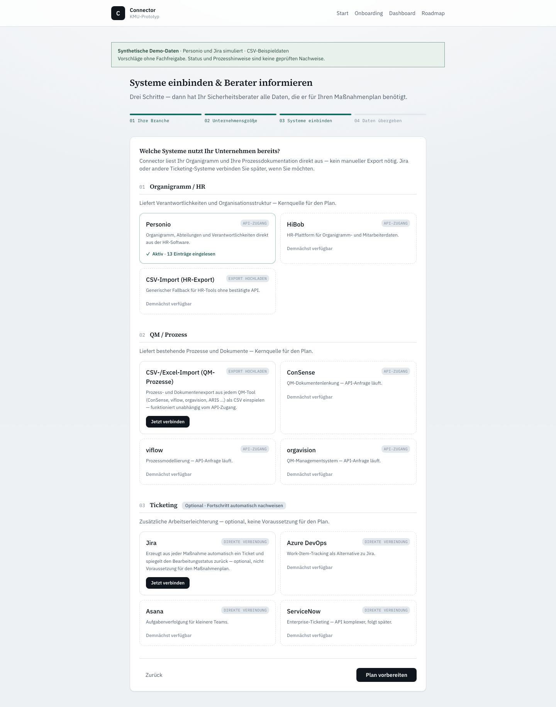
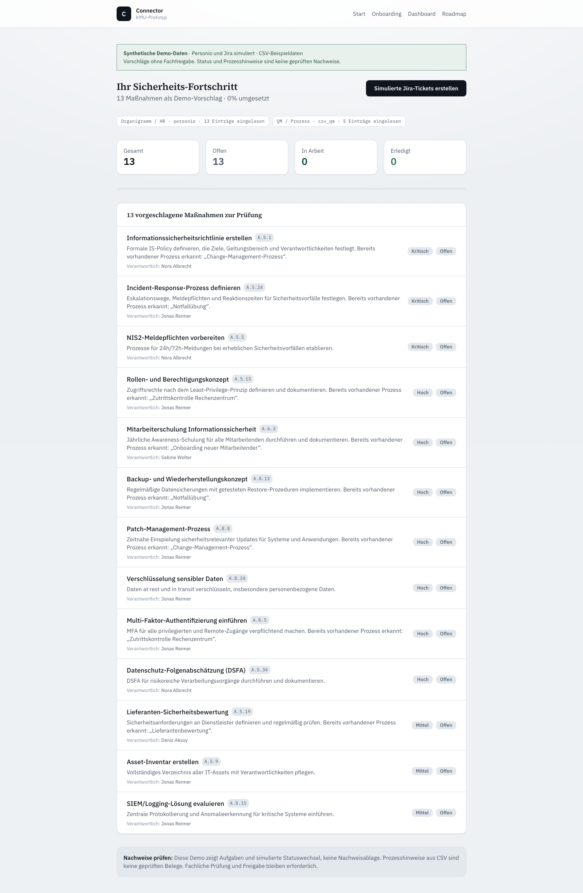
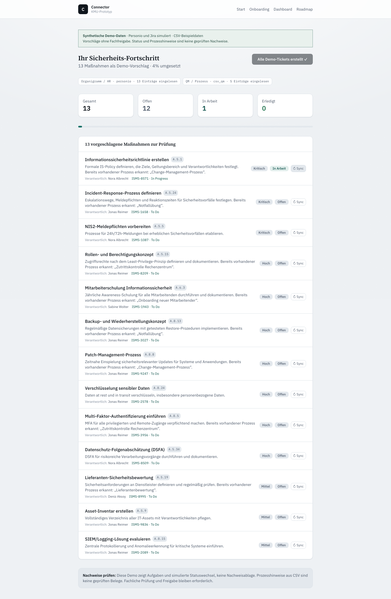

# Cyber Security Connector: Forschungs-Showcase

**Vorhandene HR-, Qualitäts- und Onboarding-Daten in nachvollziehbare Maßnahmen, Aufgaben und Nachweise übersetzen.**

Der private Forschungsprototyp heißt im Quellcode **Lotse**. Er untersucht, wie kleine und mittlere Unternehmen und ihre Cyber-Security-Partner vorhandene Informationen für eine strukturierte Sicherheits-Arbeitsstrecke nutzen können: Welche Aufgaben fehlen, wer könnte sie bearbeiten und welche Hinweise müssen fachlich geprüft werden?

Dies ist eine **kuratierte technische Ansicht**, keine vollständige Anwendung, kein veröffentlichtes Produkt und kein einsatzbereites Compliance-System. Das Hauptprojekt bleibt privat. Dieses eigenständige Showcase wird mit Freigabe des Eigentümers öffentlich bereitgestellt; der vollständige Produktcode und seine Git-Historie bleiben privat.

## Produktidee und Verantwortung

```text
Onboarding + HR/Organigramm + QM/Prozessdaten
                 ↓
    normalisierte Datensätze mit Herkunft
                 ↓
   regelbasierte Vorschläge und Maßnahmen
                 ↓
       fachliche Prüfung durch Menschen
                 ↓
 optionale Tickets → Fortschritt → Nachweisprüfung
                 ↓
    Management- und Auditdokumentation (Ziel)
```

Der Nutzen liegt nicht im automatischen Bescheinigen von Sicherheit, sondern im Vorbereiten einer überprüfbaren Arbeitsgrundlage. Ticketing ist optional; ein Maßnahmenplan kann bereits aus Onboarding-Antworten entstehen. Partner-CRM ist ein separater Intake-Pfad, keine Voraussetzung für den Maßnahmenplan.

**Menschliche Freigabe ist eine Produktanforderung, noch kein durchgängig erzwungenes Sicherheitsmerkmal.** Positive Wirksamkeitsbestätigungen, Risikoakzeptanzen, Rechtsentscheidungen und der fachliche Abschluss einer Maßnahme müssen bei berechtigten Menschen bleiben. Die aktuelle Demo und die gezeigten Exportfunktionen erzwingen diese Grenze nicht vollständig.

## So sieht die Arbeitsstrecke aus

Drei echte Browseraufnahmen der lokal gestarteten KMU-App, keine Mockups. **Alle Daten sind synthetisch; Personio und Jira sind simuliert.** Die isolierte Kopie erhält einen sichtbaren Demo-Hinweis und präzisierte Vorschlags-/Ticketlabels. Es gibt keine durchgängig erzwungene Fachfreigabe und keine geprüfte Nachweisablage.

### 1. Datenquellen statt Doppelpflege



Das Onboarding erfasst Branche und Größe. Hier hat der simulierte Personio-Adapter 13 synthetische Personen-/Abteilungseinträge eingelesen. Weitere Marketplace-Karten sind keine bestätigten Integrationen.

### 2. Maßnahmen zur fachlichen Prüfung vorbereiten



Aus Onboarding, HR und fünf CSV-Beispielprozessen entstehen 13 Vorschläge mit Priorität, möglichen Verantwortlichen und Prozesshinweisen. „Bereits vorhandener Prozess erkannt“ bedeutet einen heuristischen Treffer, nicht Wirksamkeit oder Compliance. Die Namen gehören zum eingebauten Demo-Datensatz.

### 3. Aufgaben verfolgen, Nachweisgrenze sichtbar halten



Die tatsächlichen lokalen Demo-API-Routen erzeugen simulierte Ticketreferenzen. Ein Klick auf Sync setzt eine Aufgabe auf „In Arbeit“. Die angezeigten 4 % sind nur die Statusformel, kein Sicherheitsgrad. **Eine Nachweis-/Evidence-Oberfläche ist in diesem KMU-Dashboard nicht implementiert**; deshalb zeigt das dritte Bild Aufgaben und die explizite Nachweisgrenze statt einer erfundenen Evidence-Ansicht.

[Aufnahme, Isolation, Anpassungen und Grenzen](docs/SCREENSHOTS.md) · [Maschinenlesbarer Laufbeleg](docs/screenshots/capture-report.json)

## Was ist vorhanden, was ist geplant?

„Vorhanden“ bedeutet hier: im privaten Quellcode durch statische Inspektion identifiziert. Der öffentliche Codeauszug und eine isolierte lokale App-Demo mit synthetischen Daten wurden ausgeführt. Frühere Test- oder Auditangaben des privaten README werden nicht als aktuelle Ergebnisse übernommen.

| Bereich | Ehrliche Einordnung |
| --- | --- |
| KMU- und Partneroberfläche | Next.js-/React-Demos vorhanden; KMU-Onboarding, Maßnahmen und simulierte Tickets lokal im Browser ausgeführt. Kein Deploymentnachweis. |
| Maßnahmen aus mehreren Quellen | Regelbasierter Generator vorhanden: Onboarding erzeugt den Basisplan, HR ergänzt Owner-Vorschläge, QM ergänzt Prozesshinweise. Heuristiken ersetzen keine fachliche Prüfung. |
| HR / Personio | Demo-Adapter liefert einen fest eingebauten Datensatz. Der untersuchte `pull`-Pfad ruft keine Personio-Live-API auf. |
| QM / Prozessimport | Einfacher, semikolongetrennter CSV-Parser vorhanden. Kein vollständiger CSV-Standardparser, kein nativer XLSX-Import und kein Nachweis einer QM-Herstellerintegration. |
| Partner-CRM / HubSpot | Demo-Kundenimport vorhanden; der Live-Pfad wirft ausdrücklich einen Fehler. |
| Ticketing / Jira | Mock-Tickets und simulierte Statusänderungen vorhanden; Live-Codepfade sind kein Nachweis eines funktionierenden, autorisierten End-to-End-Connectors. |
| Weitere Ticketziele | Namen im Export-Datenmodell, keine bestätigten Azure-DevOps-, Asana- oder ServiceNow-Integrationen. |
| Assessment / Nachweise | Regelbasierte Vorbefüllung mit Quellenreferenzen, Konfidenz und Review-Flag vorhanden. Keine geprüfte Nachweisablage oder unabhängige Wirksamkeitsprüfung. |
| Berichte / Auditpakete | Datenmodelle und Builder vorhanden; kein fertiger PDF-/DOCX-/XLSX-Renderer, kein Audit- oder Zertifizierungsnachweis. |
| Datenbank | Supabase-/Postgres-Migrationen vorhanden; Migration ist kein Nachweis für angewandtes Schema, Mandantentrennung oder produktive Persistenz. |
| KI | KI-Unterstützung ist ein möglicher Ausbau. Der hier beschriebene Maßnahmen-/Assessment-Pfad arbeitet regelbasiert; keine validierte KI-Produktfunktion behauptet. |
| Betrieb / Sicherheit | Authentisierung, Autorisierung, durchgängige Review-Gates, sichere Tokenverwaltung, RLS und Betriebsprozesse sind vor realen Daten gesondert umzusetzen bzw. zu prüfen. |

Details und genaue Quellbelege: [Implementierungsstand](docs/STATUS.md), [Architektur](docs/ARCHITECTURE.md) und [Sicherheitsmodell](docs/SECURITY.md).

## Kleiner unveränderter Originalauszug

Enthalten sind eine reine TypeScript-Datei für **Ticket-Exportdatensätze und Fortschrittsberechnung** sowie ihre zwei Typabhängigkeiten. Sie illustrieren die Trennung zwischen kanonischer Maßnahme und austauschbarem Ticketziel. Keine Funktion in diesem Auszug ruft ein Kundensystem auf.

Mit Node.js ab 22.18, ohne externe Pakete, Zugangsdaten oder private Quelldateien:

```bash
npm test
shasum -a 256 -c MANIFEST.sha256
```

Die acht Tests nutzen ausschließlich neu erstellte synthetische Maßnahmen. Sie prüfen Exportfelder, Prioritäten, leere und optionale Werte, Eingabeerhalt und Fortschrittszählung. Ein Test dokumentiert ausdrücklich die Grenze: `done` zählt auch ohne geprüften Nachweis als erledigt. Der berechnete Prozentwert ist **kein Sicherheits- oder Compliance-Score**.

- [Komponenten und Grenzen](components/README.md)
- [Prüfumfang und tatsächliche Ergebnisse](docs/VERIFICATION.md)
- [Relative Herkunft und SHA-256-Hashes](PROVENANCE.json)
- [Dateimanifest](MANIFEST.sha256)

## Nicht zugesagt

Keine automatische NIS-2-/BSIG-Konformität, ISO-Zertifizierung, Rechtsberatung, bestätigte Betroffenheitsprüfung, Kundenwirkung, Zeitersparnis, Produktionsreife, sichere Mehrmandantenfähigkeit oder erfolgreiche Live-Integration. NIS-2 ist hier ein Forschungs- und Modellierungskontext, kein fachlich freigegebener Compliance-Katalog. Es werden keine Pilotkennzahlen als erreichte Ergebnisse dargestellt.

## Rechte und Veröffentlichungsgrenze

Texte und ausgewählte Originalauszüge bleiben **proprietär**; siehe [LICENSE](LICENSE). Öffentlich einsehbar bedeutet nicht Open Source. Dieses eigenständige Repository enthält keine private Git-Historie, Betriebs- oder Zugangskonfiguration, Kundendaten, internen Marktstudien oder fremden Normtexte. Die drei neu aufgenommenen App-Bilder zeigen ausschließlich den eingebauten synthetischen HR-/QM-Datensatz und simulierte Tickets. Keine Bestandsdaten, Zugangsdaten oder privaten Betriebsdateien werden übernommen.
