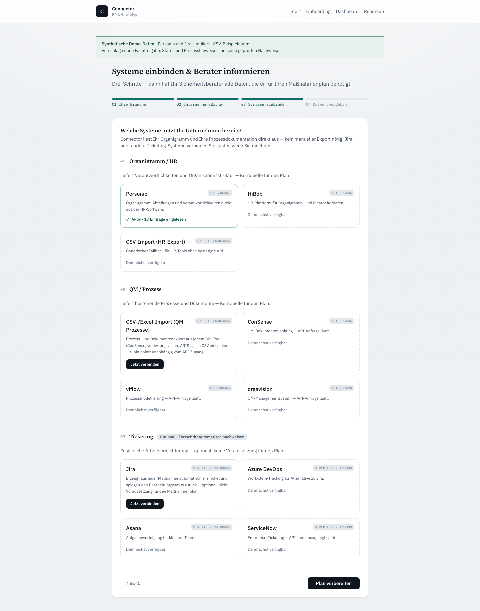
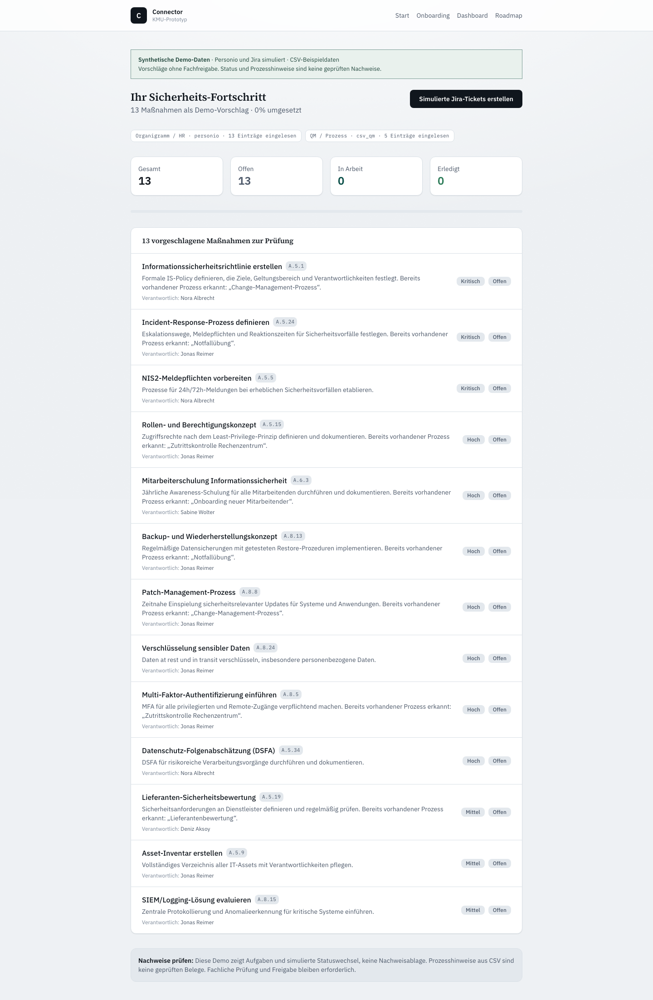
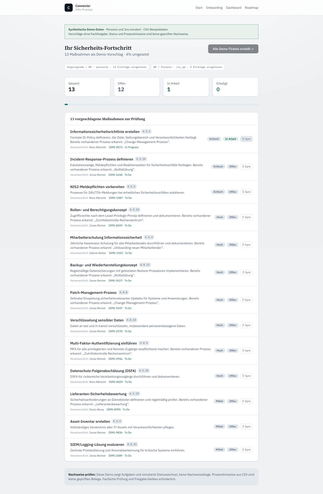

# Lotse: research showcase

**English** | [Deutsch](README.de.md)

**From company documents to a traceable assessment, guided decisions, tracked measures, and executive reviews.**

**Lotse** is a private research prototype for a SaaS product that companies can use directly. It is designed to turn existing company documents into a traceable NIS2 assessment and guide responsible people through open decisions and measures. Implementation tracking and required internal executive reviews belong to the core product goal. Consulting partners can support the work, but are not required to buy, introduce, or use Lotse.

This is a **curated technical view**, not a complete application, a released product, or a deployment-ready compliance system. The main project remains private. This standalone showcase is made publicly available with the owner's approval; the complete product code and its Git history remain private.

## Product idea and responsibility

```text
Target workflow, not fully implemented:
Existing company documents + optional connected data
                 ↓
       traceable assessment with sources and gaps
                 ↓
      human review and assigned decisions/measures
                 ↓
           guided work and implementation tracking
                 ↓
 executive report → acknowledgement and approvals
                 ↓
    audit package from the same approved data
```

The current demos cover parts of that goal using onboarding, HR and process data, rule-based suggestions, and simulated tickets. Document analysis, guided decisions, reminders, evidence-based completion, and executive acknowledgement/approval are not yet a complete implemented workflow. Ticketing is optional; onboarding answers alone can generate an action plan. Partner CRM is a separate optional intake path, not the primary product model.

Required executive reports mean an internal review workflow with a named recipient, agreed review date, acknowledgement, and required approvals, not a claim of a legally prescribed report format or frequency. Executive training is a possible addition, not a committed or implemented module. Reading a report does not constitute training completion.

**Human approval is a product requirement, not yet a consistently enforced security feature.** Positive effectiveness confirmations, risk acceptance, legal decisions, and expert sign-off on measures must remain with authorised people. The current demo and the export functions shown here do not fully enforce that boundary.

## What the workflow looks like

Three genuine browser captures of the locally running small-business app, not mockups. **All data is synthetic; Personio and Jira are simulated.** The isolated copy includes a visible demo notice and clarified suggestion/ticket labels. There is no consistently enforced expert approval or verified evidence repository. The application UI remains in German; English captions explain the workflow.

### 1. Use data sources instead of duplicating entry



Onboarding captures industry and company size. Here, the simulated Personio adapter imported 13 synthetic person/department entries. Other marketplace cards are not confirmed integrations.

### 2. Prepare measures for expert review



Onboarding, HR, and five CSV example processes produce 13 suggestions with priorities, possible owners, and process references. “Existing process detected” means a heuristic match, not effectiveness or compliance. The names belong to the built-in demo dataset.

### 3. Track tasks and keep evidence limitations visible



The actual local demo API routes generate simulated ticket references. Clicking Sync sets one task to “In progress”. The displayed 4% reflects only the status formula, not a security level. **An evidence interface is not implemented in this small-business dashboard**; the third image therefore shows tasks and the explicit evidence limitation rather than an invented evidence view.

[Capture, isolation, modifications, and limitations, in German](docs/SCREENSHOTS.md) · [Machine-readable execution record](docs/screenshots/capture-report.json)

## What exists, and what is planned?

“Exists” means identified in the private source code through static inspection. The public code excerpt and an isolated local app demo with synthetic data were executed. Earlier test or audit statements in the private README are not reused as current results.

| Area | Evidence and limitations |
| --- | --- |
| Small-business and partner interfaces | Next.js/React demos exist; small-business onboarding, measures, and simulated tickets were exercised locally in the browser. No deployment evidence. |
| Measures from multiple sources | A rule-based generator exists: onboarding creates the base plan, HR adds proposed owners, and quality-management data adds process references. Heuristics do not replace expert review. |
| HR / Personio | Demo adapter supplies a built-in dataset. The inspected `pull` path does not call the live Personio API. |
| Quality management / process import | A simple semicolon-separated CSV parser exists. Not a fully standards-compliant CSV parser, no native XLSX import, and no evidence of a quality-management vendor integration. |
| Partner CRM / HubSpot | Demo customer import exists; the live path explicitly throws an error. |
| Ticketing / Jira | Mock tickets and simulated status changes exist; live code paths do not demonstrate a working, authorised end-to-end connector. |
| Other ticket destinations | Names in the export data model, not confirmed Azure DevOps, Asana, or ServiceNow integrations. |
| Assessment / evidence | Rule-based prefilling with source references, confidence, and a review flag exists. No verified evidence repository or independent effectiveness assessment. |
| Reports / audit packages | Data models and builders exist; no finished PDF/DOCX/XLSX renderer, audit evidence, or certification evidence. |
| Database | Supabase/Postgres migrations exist; a migration does not demonstrate an applied schema, tenant isolation, or production persistence. |
| AI | AI assistance is a possible extension. The measures/assessment path described here is rule-based; no validated AI product feature is claimed. |
| Operations / security | Authentication, authorisation, end-to-end review gates, secure token management, RLS, and operational processes must be implemented or separately verified before using real data. |

Details and precise source evidence, in German: [implementation status](docs/STATUS.md), [architecture](docs/ARCHITECTURE.md), and [security model](docs/SECURITY.md).

## Small, unchanged original excerpt

Included are a pure TypeScript file for **ticket-export records and progress calculation**, plus its two type dependencies. They illustrate the separation between a canonical measure and interchangeable ticket destinations. No function in this excerpt calls a customer system.

Requires Node.js 22.18 or later, with no external packages, credentials, or private source files:

```bash
npm test
shasum -a 256 -c MANIFEST.sha256
```

The eight excerpt tests use only newly created synthetic measures. They check export fields, priorities, empty and optional values, input preservation, and progress counting. One test explicitly documents the limitation: `done` counts as completed even without verified evidence. The calculated percentage is **not a security or compliance score**.

- [Components and limitations, in German](components/README.md)
- [Validation scope and actual results, in German](docs/VERIFICATION.md)
- [Relative provenance and SHA-256 hashes](PROVENANCE.json)
- [File manifest](MANIFEST.sha256)

## Not promised

No automatic NIS-2/BSIG compliance, ISO certification, legal advice, confirmed applicability assessment, customer impact, time savings, production readiness, secure multitenancy, or successful live integration. NIS-2 is a research and modelling context here, not an expert-approved compliance catalogue. No pilot metrics are presented as achieved outcomes.

## Rights and publication boundary

Text and selected original excerpts remain **proprietary**; see [LICENSE](LICENSE). Publicly viewable does not mean open source. This standalone repository contains no private Git history, operational or access configuration, customer data, internal market studies, or third-party standards text. The three newly captured app images show only the built-in synthetic HR/quality-management dataset and simulated tickets. No existing operational data, credentials, or private operational files are included.
